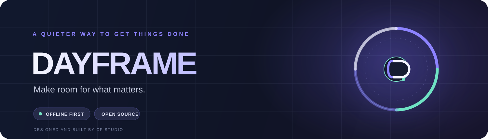
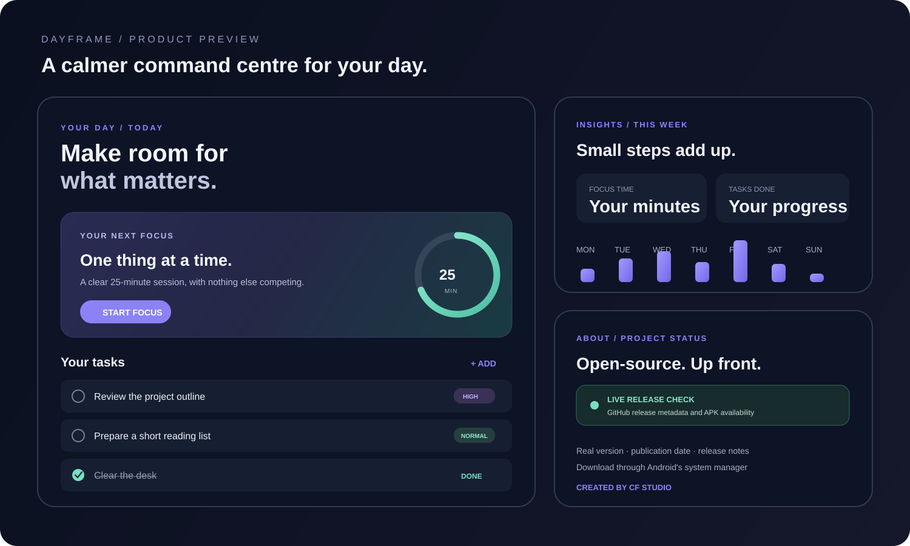

# DAYFRAME

**Make room for what matters.**

An offline-first daily planner and focus companion for Android. Plan with intention, work in focused sessions, and see your progress — without an account, a subscription, or a cloud dependency.

[Features](#-features) · [Design](#-design) · [Build](#-build) · [Updates](#-in-app-update-center) · [About](#-about-the-project)

---

## The idea

DAYFRAME is a small, thoughtful workspace for your day. It brings three things together: a task list you can trust, a focus timer that stays out of your way, and a clear view of the time you have invested.

It is **local-first by design**. Your tasks and focus sessions live on your device. The app does not ask you to create an account, does not send your personal planner data to a server, and keeps its core features available offline. Internet is used only when you explicitly check the public project update feed.

## ✦ Features

| Area | What works |
|---|---|
| **Today** | Create tasks, set a priority, mark them complete, and remove them |
| **Focus** | 15 / 25 / 45 / 60-minute sessions, live countdown, pause, resume and reset |
| **Insights** | Completed-task totals, focus minutes and a seven-day activity view |
| **Persistence** | Tasks and completed focus sessions are stored locally and restored on launch |
| **Adaptive UI** | Compact portrait layout and a two-panel wide / landscape layout |
| **Motion** | Animated launch mark, page transitions, progress rings, task feedback and content resizing |
| **Update center** | Reads real GitHub Releases and Actions status; shows release notes and a published APK link when one exists |
| **About** | Project purpose, creator attribution, app version and update history |

### Product preview

> The preview is an original vector illustration of the interface. The actual screens are built in Jetpack Compose and adapt to the available app window.

## Design

DAYFRAME uses a quiet midnight palette, restrained violet accents, mint progress signals, generous spacing and clear typographic hierarchy. It takes its interaction cues from Android's Material 3 guidance while using a custom visual system for a more editorial feel.

The layout responds to **available window width**, not a hard-coded device model. On compact screens, navigation sits at the bottom. On wider windows and landscape phones, navigation moves to a rail and the main content can use two columns. Motion is implemented with Compose animation APIs rather than video or decorative GIFs.

## Download

There is no APK attached to this first source commit. The Android CI workflow builds a debug APK for each successful run and uploads it as a GitHub Actions artifact.

- [Open the latest successful CI run](https://github.com/CFSTUDIO-project/Open-source/actions/workflows/android-ci.yml)
- [Open published releases](https://github.com/CFSTUDIO-project/Open-source/releases)

The in-app update center reads the repository's public release metadata. It only displays a download action when a published release actually contains an .apk asset. It does not invent a version or pretend an update is available.

## Build

### Requirements

- Android Studio with Android SDK 35
- JDK 17
- Gradle 8.10.2 (the CI workflow provisions this version)

### Build a debug APK

From the project root:

~~~bash
gradle --no-daemon assembleDebug
~~~

APK output:

~~~text
app/build/outputs/apk/debug/app-debug.apk
~~~

To install it on a connected Android device:

~~~bash
gradle --no-daemon installDebug
~~~

### Project structure

~~~text
.
├── app/
│   └── src/main/
│       ├── java/app/dayframe/mobile/
│       │   ├── MainActivity.kt
│       │   ├── data/
│       │   │   ├── DayframeStore.kt
│       │   │   └── UpdateService.kt
│       │   └── ui/
│       │       ├── DayframeApp.kt
│       │       └── DayframeTheme.kt
│       ├── res/
│       └── AndroidManifest.xml
├── assets/
├── .github/workflows/
└── README.md
~~~

## In-app update center

The update panel checks these public endpoints in this repository:

- GET /repos/CFSTUDIO-project/Open-source/releases?per_page=8
- GET /repos/CFSTUDIO-project/Open-source/actions/runs?per_page=1&branch=main

The status meanings are deliberately literal:

- **Green — available:** a published release includes an APK asset. The app distinguishes an update from the version already installed.
- **Yellow — building:** the latest GitHub Actions run is queued or in progress.
- **Red — unavailable:** no published APK release is available yet.

The panel shows the real release tag, publication date, release notes, and asset download URL. It refreshes when the About page opens and periodically while that page remains visible. Downloading uses Android's system Download Manager. Installing an APK still requires the device owner's confirmation and Android's package-install permission.

A public repository has GitHub API rate limits. If a request fails, the app reports that it could not refresh instead of displaying stale data as live.

## Privacy

- No account or analytics SDK.
- No advertising SDK.
- No planner data is uploaded.
- Tasks and focus sessions are stored in app-private local preferences.
- Network access is used for the public GitHub update feed only.

## Contributing

Issues and pull requests are welcome. Please keep changes focused, explain the user-facing behavior, and test both compact portrait and wide / landscape layouts.

See [CONTRIBUTING.md](CONTRIBUTING.md) for the contribution workflow.

## About the project

**DAYFRAME** is an independent open-source Android project created by **CF Studio**.

The goal is simple: build a useful daily workspace that feels considered, stays fast on everyday phones, and remains transparent about what it does. The app is intentionally usable without signing in or depending on a paid service.

- **Application:** DAYFRAME
- **Android package:** app.dayframe.mobile
- **APK filename (CI artifact):** app-debug.apk
- **Current source version:** 1.0.0
- **Creator:** CF Studio
- **Repository:** [CFSTUDIO-project/Open-source](https://github.com/CFSTUDIO-project/Open-source)
- **License:** MIT

### Update history

See [CHANGELOG.md](CHANGELOG.md) for the source-level history. Published APK dates and release notes shown inside the app are fetched from GitHub Releases.

---

**DAYFRAME · Make room for what matters.**

Built with care by **CF Studio** · Open source under the MIT License

